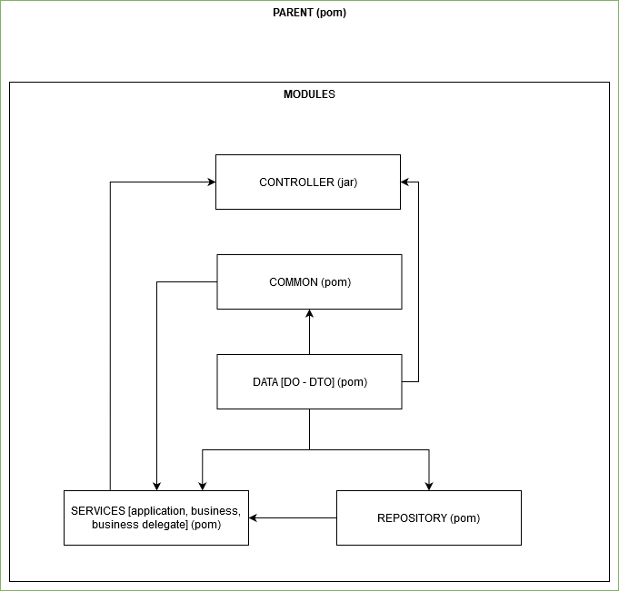

# Quarkus Multi-Module Microservice Template

A reusable foundation for building Java microservices with Quarkus.

## Purpose

This project serves as a reusable foundation for building backend services with a consistent architecture and project structure.

The goal is to reduce project setup effort and encourage the adoption of clean and maintainable architectural practices.

## Features

- Multi-module Maven architecture
- Clean separation of concerns
- Quarkus-ready project structure
- Environment-specific configuration profiles
- Easy extension management
- Reusable foundation for microservices

# Getting Started

## Requirements

- Maven 3.6.3
- Java 11

Clone or download the project, then run the following commands:

```bash
mvn clean install
mvn quarkus:dev
```

For remote debugging:

```bash
mvn clean install
mvn clean compile quarkus:dev -Ddebug
```

### Running with a Specific Profile

If no profile is specified, the `prod` profile is used by default.

```bash
mvn clean install

QUARKUS_PROFILE=dev java -jar controller/target/mcs-quarkus-poc-1.0-SNAPSHOT-runner.jar
```

# Creating a New Project

## Create a Clean Architecture Project

This project follows a multi-module Maven structure adapted for Quarkus.

The idea is to organize the application into separate modules with clear responsibilities while using Quarkus as the runtime framework.

## Target Project Structure

- Parent POM
  - Controller (Entry Point)
    - Dependency: Common
    - Dependency: Services
    - Dependency: Data
  - Services
    - Dependency: Data
    - Dependency: Common
    - Dependency: Repository
  - Repository
    - Dependency: Data
  - Common
    - Dependency: Data



### Create the Parent Project

Create the parent project that will host all modules by running the following command:

```bash
mvn archetype:generate -DgroupId=group.id -DartifactId=mcs_quarkus_poc
```

### Configure the Parent POM

Open the `pom.xml` file and set the packaging type to `pom`:

```xml
<packaging>pom</packaging>
```

### Create the Modules

Create the project modules by executing the following commands:

```bash
mvn archetype:generate -DgroupId=group.id -DartifactId=controller
mvn archetype:generate -DgroupId=group.id -DartifactId=services
mvn archetype:generate -DgroupId=group.id -DartifactId=repository
mvn archetype:generate -DgroupId=group.id -DartifactId=data
mvn archetype:generate -DgroupId=group.id -DartifactId=common
```

### Register the Modules

Add the following section to the parent project's `pom.xml`:

```xml
<modules>
    <module>controller</module>
    <module>services</module>
    <module>repository</module>
    <module>data</module>
    <module>common</module>
</modules>
```

### Add Module Dependencies

Add the following dependency declaration to the module's `pom.xml` file for each required dependency (see the target structure above):

```xml
<dependency>
    <groupId>${group_id}</groupId>
    <artifactId>${artifact_id}</artifactId>
    <version>${pom.version}</version>
    <type>jar</type>
    <scope>compile</scope>
</dependency>
```

## Configure the Project to Run with Quarkus

### Configure the Parent POM

Update the parent project's `pom.xml` file as follows:

```xml
<properties>
    <project.build.sourceEncoding>UTF-8</project.build.sourceEncoding>
    <quarkus-plugin.version>1.8.1.Final</quarkus-plugin.version>
    <quarkus.platform.artifact-id>quarkus-universe-bom</quarkus.platform.artifact-id>
    <quarkus.platform.group-id>io.quarkus</quarkus.platform.group-id>
    <quarkus.platform.version>1.8.1.Final</quarkus.platform.version>
</properties>
```

```xml
<dependencyManagement>
    <dependencies>
        <dependency>
            <groupId>${quarkus.platform.group-id}</groupId>
            <artifactId>${quarkus.platform.artifact-id}</artifactId>
            <version>${quarkus.platform.version}</version>
            <type>pom</type>
            <scope>import</scope>
        </dependency>
    </dependencies>
</dependencyManagement>
```

```xml
<build>
    <plugins>
        <plugin>
            <groupId>io.quarkus</groupId>
            <artifactId>quarkus-maven-plugin</artifactId>
            <version>${quarkus-plugin.version}</version>
        </plugin>
    </plugins>
</build>
```

### Configure the Main Module (Entry Point)

Update the `controller/pom.xml` file as follows:

```xml
<properties>
    <quarkus-plugin.version>1.8.1.Final</quarkus-plugin.version>
</properties>
```

```xml
<build>
    <plugins>
        <plugin>
            <groupId>io.quarkus</groupId>
            <artifactId>quarkus-maven-plugin</artifactId>
            <version>${quarkus-plugin.version}</version>
            <executions>
                <execution>
                    <goals>
                        <goal>generate-code</goal>
                        <goal>build</goal>
                    </goals>
                </execution>
            </executions>
        </plugin>
    </plugins>
</build>
```

### Configure the Remaining Modules

For the `common`, `data`, `repository`, and `services` modules, configure the Maven Compiler Plugin as follows:

```xml
<build>
    <plugins>
        <plugin>
            <artifactId>maven-compiler-plugin</artifactId>
            <version>3.6.1</version>
            <configuration>
                <release>11</release>
            </configuration>
        </plugin>
    </plugins>
</build>
```

## Generate the Configuration File

The `application.properties` file should be located in the main module (`controller`).

Open a terminal from the `controller` module and execute the following command:

```bash
mvn io.quarkus:quarkus-maven-plugin:1.8.1.Final:generate-config -Dfile=application.properties
```

This command generates an `application.properties` file containing all available Quarkus configuration properties.

All application-specific Quarkus configurations should be defined in this file.

## Configure the HTTP Host and Port

Define the host and port in the `application.properties` file:

```properties
quarkus.http.host=localhost
quarkus.http.port=8080
```

## Custom Profiles

Quarkus provides built-in `dev` and `prod` profiles. Each profile can have its own configuration values.

For example:

```properties
%dev.quarkus.http.host=dev_server_host
%prod.quarkus.http.host=prod_server_host
```

### Creating a Custom Profile

Creating a custom profile is straightforward. Simply prefix a configuration property with `%<profile-name>`.

For example, to create a `staging` profile, add theowing configuration to the `application.properties` file:

```properties
%staging.quarkus.http.host=staging_server_host
```

### Running with a Custom Profile

Use the `QUARKUS_PROFILE` environment variable to activate a custom profile:

```bash
QUARKUS_PROFILE=staging \
java -jar controller/target/mcs-quarkus-poc-1.0-SNAPSHOT-runner.jar
```

## Add Quarkus Extensions

Quarkus functionality is provided through extensions. Add only the extensions required by your service to keep the application lightweight and maintainable.

Use the following command to add one or more Quarkus extensions to the project:

```bash
mvn quarkus:add-extension -Dextensions="extension_comma_separated_list"
```

For example, to add the RESTEasy and RESTEasy Jackson extensions:

```bash
mvn quarkus:add-extension -Dextensions="resteasy,resteasy-jackson"
```

### Verify Installed Extensions

You can list all installed extensions using:

```bash
mvn quarkus:list-extensions
```
